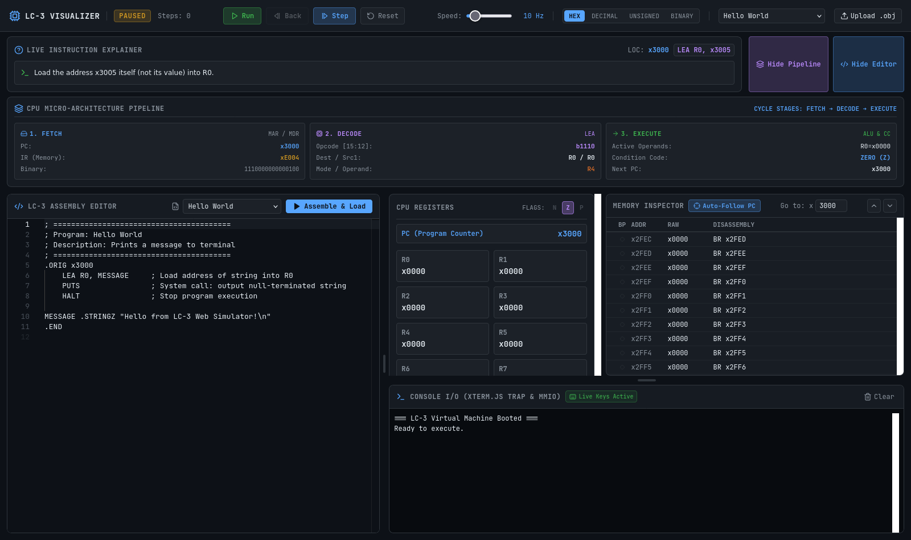

# 🖥️ LC-3 Web Visualizer & Interactive IDE

> A browser-based virtual machine, disassembler, two-pass assembler, and educational visualizer for the **LC-3 (Little Computer 3)** architecture.


---

## 📸 Interface Preview



---

## ✨ Features

- **Monaco Code Editor with LC-3 Tokenizer**: Write LC-3 assembly code directly in the browser with full syntax highlighting, starter code templates, and inline compile error markers.
- **In-Browser Two-Pass Assembler**: Automatically compiles `.asm` text into 16-bit binary machine words and loads them directly into memory at `.ORIG`.
- **Time-Travel Debugging (Step Back / Undo)**: Accidental step past a loop? Click **`⏮ Back`** (or press `F11` / `Shift+F10`) to rewind CPU cycles through a 50-state snapshot ring buffer.
- **CPU Micro-Architecture Pipeline Visualizer**: Live hardware diagram displaying **Fetch** (`PC` ➔ `MAR` ➔ `IR`), **Decode** (Opcode, `DR`, `SR1`, `SR2`/imm5), and **Execute** (ALU calculation & Condition Codes `N`, `Z`, `P`).
- **Live Plain-English Explainer**: Dynamically translates every executed instruction into natural language (e.g. `ADD R1, R2, #5` ➔ *"Read R2, add 5, write to R1, set flag to POSITIVE"*).
- **Interactive Terminal (`xterm.js`)**: Real character-by-character keyboard input (`GETC` / `IN`) and console output (`OUT`, `PUTS`, `PUTSP`). Supports memory-mapped I/O (`KBSR` / `KBDR`).
- **Memory Inspector with Breakpoints**: 65,536-row virtualized view of flat memory with margin breakpoints, auto-scroll to PC, and address jumping.
- **Binary Image (.obj) Loader**: Drag and drop or upload compiled LC-3 `.obj` binary files, with bundled classic games (`2048.obj` and `rogue.obj`).
- **Dockable Resizable Panels**: Built with `react-resizable-panels` for an IDE-grade user experience.

---

## 🚀 Quick Start

### Prerequisites
- Node.js (v18+)
- npm

### Installation & Development
```bash
# Navigate to web directory
cd web

# Install dependencies
npm install

# Start local dev server
npm run dev
```

Visit `http://localhost:5173/` in your browser.

### Production Build
```bash
npm run build
npm run preview
```

---

## ⌨️ Keyboard Shortcuts

| Shortcut | Action |
|---|---|
| `F10` | Step forward (1 instruction) |
| `Shift + F10` / `F11` | Step backward (Undo cycle) |
| `F5` | Run / Pause execution |
| `Esc` | Pause execution |
| `F9` | Toggle breakpoint at current PC |
| `Ctrl + Shift + R` | Reset CPU state and reload program |

---

## 📂 Architecture & Directory Structure

```
web/
├── public/
│   └── examples/           # Pre-compiled .obj binaries (2048.obj, rogue.obj)
├── src/
│   ├── types/
│   │   ├── lc3.ts          # Core CPU specifications (opcodes, flags, memory, state)
│   │   └── worker.ts       # Typed Web Worker interface contract
│   ├── lib/
│   │   ├── assembler.ts    # In-browser two-pass LC-3 assembler
│   │   ├── disassembler.ts # 16-bit instruction word -> assembly mnemonic
│   │   ├── explainer.ts    # Natural language explainer engine
│   │   ├── format.ts       # Base conversions (hex, decimal, unsigned, binary)
│   │   ├── obj-loader.ts   # Big-endian .obj binary image reader
│   │   └── mock-programs.ts# Starter templates and programs
│   ├── store/
│   │   └── useLc3Store.ts  # Reactive Zustand store & execution engine
│   ├── hooks/
│   │   └── useKeyboardShortcuts.ts
│   ├── components/
│   │   ├── layout/AppLayout.tsx    # Resizable multi-panel IDE container
│   │   ├── CodeEditor.tsx          # Monaco assembly editor
│   │   ├── ExecutionControls.tsx   # Run, pause, step, back, speed slider, uploader
│   │   ├── ExplainerBanner.tsx     # Plain-English translation banner
│   │   ├── MemoryInspector.tsx     # 65K virtualized table with margin breakpoints
│   │   ├── PipelineVisualizer.tsx  # Fetch-Decode-Execute micro-architecture stage view
│   │   ├── RegisterDashboard.tsx   # Live R0-R7, PC, flags
│   │   └── Terminal.tsx            # Live xterm.js console
│   └── worker/
│       └── lc3.worker.ts   # Background thread execution bridge
└── WASM_INTEGRATION_GUIDE.md # C++ Emscripten integration guide for teammate 2
```
